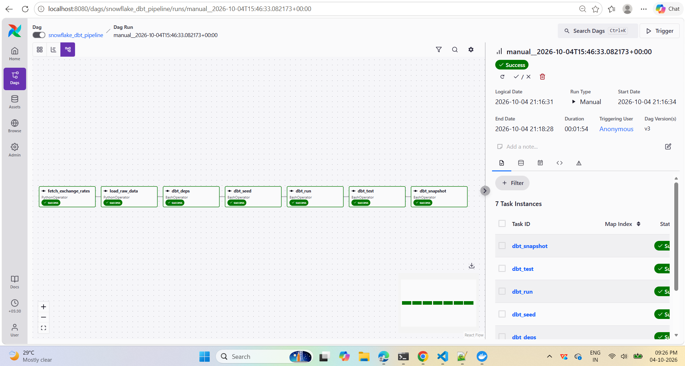
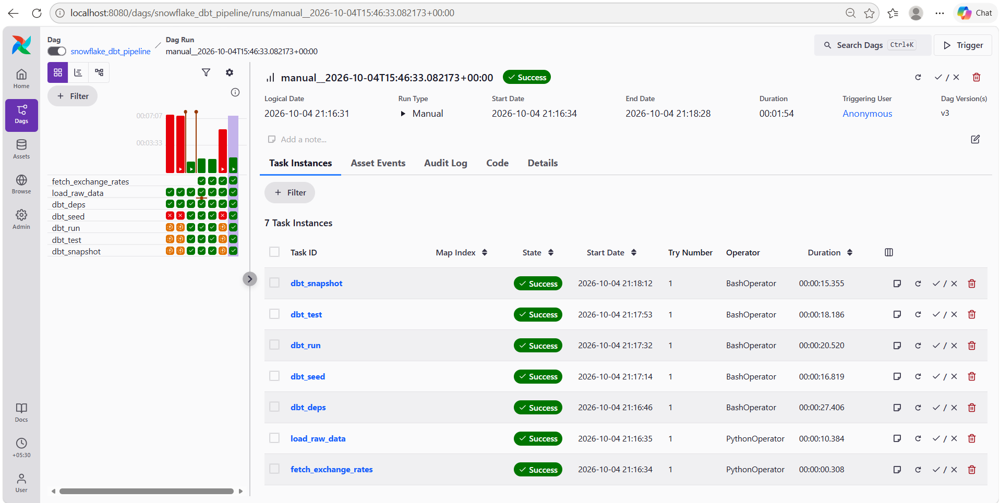
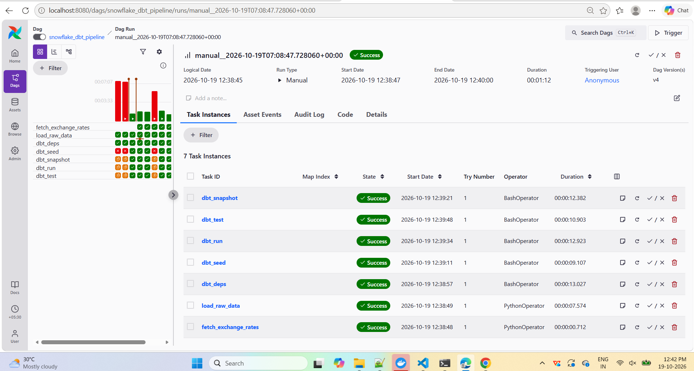

# Snowflake + dbt + Airflow ELT Pipeline

An end-to-end ELT pipeline: exchange rates are fetched from a public API and sample sales data is loaded into **Snowflake**, transformed with **dbt** (staging → intermediate → marts → star schema), validated with data tests, and orchestrated by **Apache Airflow** running in **Docker** (Astro CLI).

This extends my earlier Snowflake + dbt project: [Jahnavi-L-2001/project](https://github.com/Jahnavi-L-2001/project).

## Pipeline flow

`fetch_exchange_rates` → `load_raw_data` → `dbt_deps` → `dbt_seed` → `dbt_snapshot` → `dbt_run` → `dbt_test`

| Task | What it does |
|---|---|
| `fetch_exchange_rates` | Python calls the Frankfurter API (INR→USD rates), parses the JSON response, and writes a CSV |
| `load_raw_data` | Connects to Snowflake, uploads the CSVs to an internal stage, and loads the RAW tables with `COPY INTO` |
| `dbt_deps` | Installs dbt packages (`dbt_utils`) |
| `dbt_seed` | Loads reference data (`valid_categories.csv`, `customers.csv`) |
| `dbt_snapshot` | Maintains SCD Type 2 history (`orders_snapshot`, `customers_snapshot`) before the models are built |
| `dbt_run` | Builds 15 models: staging views, intermediate views, mart tables, and the star schema |
| `dbt_test` | Runs 47 data tests (not null, unique, relationships, accepted values, custom tests) |

The DAG runs daily with 2 retries per task and `max_active_runs=1` to prevent overlapping runs.




## Data sources

- **Sales data** (employee, family, orders): sample CSV files in `include/data/`, created for demonstration.
- **Exchange rates:** the free [Frankfurter API](https://frankfurter.dev) (European Central Bank reference rates, no API key). It is fetched on every run.

## What is in the dbt project

- **Staging:** `stg_employee`, `stg_family`, `stg_orders`, `stg_exchange_rates` (cleaning and renaming)
- **Intermediate:** `int_employee`, `int_family`, `int_orders_incremental` (joins and an incremental model)
- **Marts:** `mart_employee_directory`, `mart_sales_by_category`, `family_masked` (with a column-masking macro), and `mart_sales_usd`
- **`mart_sales_usd`:** converts order amounts to USD using the latest exchange rate on or before each order date, because the ECB publishes rates on working days only
- **Star schema:** `fct_orders` (one row per order, incremental) with `dim_customer` (SCD Type 2), `dim_category`, and `dim_date`
- **Snapshots:** `orders_snapshot` and `customers_snapshot` (SCD Type 2). `customers_snapshot` uses the check strategy on `city` and `segment`.
- **Tests:** 47 tests, including custom SQL tests for positive order amounts and masked phone numbers, and relationships tests from the fact table to each dimension

## Star schema

**Grain:** one row per order in `fct_orders`, with amounts in INR and USD.

- `dim_customer` is SCD Type 2, built from a dbt snapshot. A new row is added only when a customer's city or segment changes, so old orders keep the city that was true when they were placed.
- The orders data only has a customer name, so I added a `customers` seed with city and segment for the dimension.
- The first version of each customer is backdated in `dim_customer`, otherwise orders placed before the snapshot first ran would not match any customer row.
- Weekend orders use the latest exchange rate on or before the order date, because the rates API has no weekend rows.
- `fct_orders` is incremental and merges on `order_id`.



## Tech stack

Snowflake, dbt Core, Apache Airflow, Docker, Astro CLI, Python, SQL, Git

## Security

Snowflake no longer accepts passwords for programmatic access, so dbt and Airflow connect with **key-pair authentication**. The private key and `.env` are never committed (see `.gitignore`).

## Problems solved along the way

- **Key-pair authentication:** switched dbt and Airflow from password login to RSA key pairs after Snowflake's authentication change.
- **Overlapping runs:** a manual and a scheduled run executed `dbt deps` at the same time and corrupted the package folder. Fixed by setting `max_active_runs=1`.
- **Data quality catch:** a dbt `relationships` test flagged an employee whose manager did not exist in the data, and I fixed it at the source.
- **Missing dbt source:** a new staging model failed until its table was declared in `sources.yml`.
- **SCD2 date join:** the first snapshot run stamped today's date as `valid_from`, so older orders found no customer row. Fixed by backdating each customer's first version in `dim_customer`.

## How to run

1. Install Docker Desktop and the Astro CLI.
2. In Snowflake, run `dags/dbt_project/snowflake-setup/sql/warehouse_database_schema.sql`, then create the file format and RAW tables:
```sql
   USE DATABASE ANALYTICS_DB;
   USE SCHEMA RAW;
   CREATE OR REPLACE FILE FORMAT csv_format TYPE = CSV SKIP_HEADER = 1 FIELD_OPTIONALLY_ENCLOSED_BY = '"';
   CREATE OR REPLACE TABLE employee (empno INT, ename STRING, job STRING, mgr INT, hiredate DATE, sal FLOAT, comm FLOAT, deptno INT);
   CREATE OR REPLACE TABLE family (parent_name STRING, gender STRING, dob DATE, city STRING, state STRING, house_number STRING, office_phone STRING, personal_phone STRING, kid_name STRING);
   CREATE OR REPLACE TABLE orders (order_id INT, customer_name STRING, order_date DATE, category STRING, amount FLOAT);
   CREATE OR REPLACE TABLE exchange_rates (rate_date DATE, base_currency STRING, target_currency STRING, rate FLOAT);
```
3. Generate an RSA key pair, attach the public key to your Snowflake user (`ALTER USER ... SET RSA_PUBLIC_KEY=...`), and save the private key as `include/keys/rsa_key.p8`.
4. Create a `.env` file in the project root:
```
   SNOWFLAKE_ACCOUNT=<orgname-accountname>
   SNOWFLAKE_USER=<your_user>
```
5. Start Airflow and open http://localhost:8080:
```
   astro dev start
```
6. Trigger the DAG `snowflake_dbt_pipeline`.

## Notes

- The sales data in `include/data/` is **sample data** created for demonstration.
- The earlier version of this project loaded data from AWS S3 using a storage integration and Snowpipe. Those scripts are kept in `dags/dbt_project/snowflake-setup/sql/`, but this version loads through an internal Snowflake stage so it runs without an AWS account.
- `snowflake-setup/snowpark/connect.py` comes from the earlier version and uses password authentication, which Snowflake no longer supports.